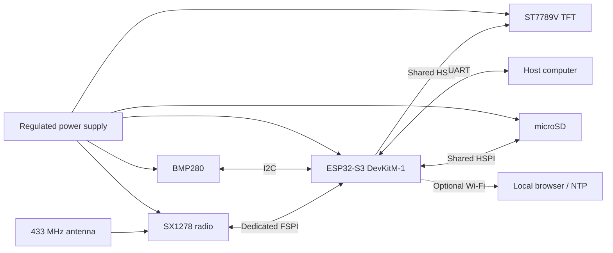
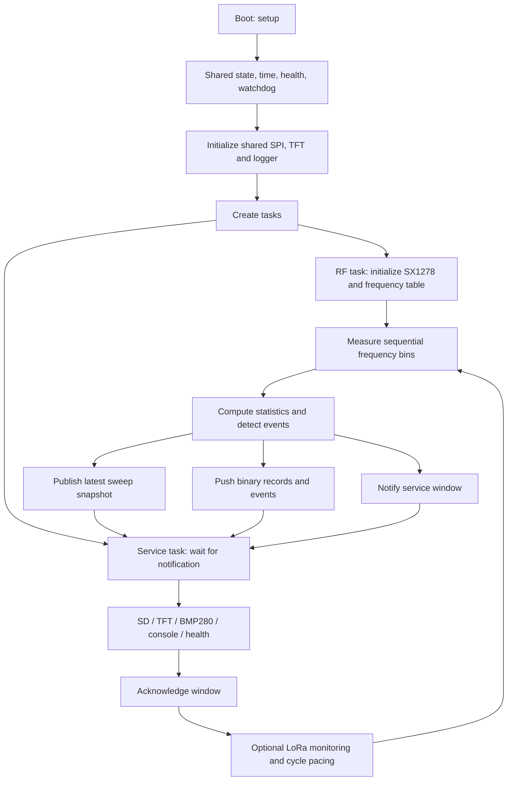

# RF-24/7 Observatory

> **Autonomous, receive-only sub-GHz RF activity monitoring and experimental characterization platform**
>
> Firmware: **v1.0.5** · Hardware: ESP32-S3 + SX1278 + ST7789V + BMP280 + microSD · Documentation basis: the supplied `RF_Observatory_v1.0.5.zip` source code.
>
> Status: cleaned firmware release; the user reported success with the preceding ST7789 version (v1.0.4), but the exact test/build environment was not specified. Host-side tests pass for v1.0.5; target compilation, integrated physical validation and RF calibration remain pending.

## Contents

1. [Project overview](#1-project-overview)
2. [Scientific objectives](#2-scientific-objectives)
3. [Hardware and wiring](#3-hardware-and-wiring)
4. [Firmware architecture](#4-firmware-architecture)
5. [RF measurement principles](#5-rf-measurement-principles)
6. [Statistical signal processing](#6-statistical-signal-processing)
7. [Anomaly detection](#7-anomaly-detection)
8. [LoRa monitoring](#8-lora-monitoring)
9. [Environmental monitoring](#9-environmental-monitoring)
10. [Display and user interface](#10-display-and-user-interface)
11. [Data logging and analysis](#11-data-logging-and-analysis)
12. [Self-interference experiments](#12-self-interference-experiments)
13. [Reliability and resource optimization](#13-reliability-and-resource-optimization)
14. [Build, operation and validation](#14-build-operation-and-validation)
15. [Research opportunities and limitations](#15-research-opportunities-and-limitations)
16. [Source code map](#16-source-code-map)

## 1. Project overview

The RF-24/7 Observatory is a low-cost embedded instrument intended to continuously observe radio-frequency activity in a narrow portion of the 433 MHz band. It measures received signal strength at successive frequencies, learns the local RF background, detects unusual changes, visualizes the observations on a TFT, and records data to a microSD card for offline analysis. A BMP280 records temperature and atmospheric pressure to provide environmental context for long-duration experiments.

The project is motivated by the question: **What can a small, inexpensive radio receiver learn about its surrounding electromagnetic environment when it operates continuously rather than only when a particular packet is expected?**

Unlike a conventional LoRa communication node, the observatory does not need a matching transmitter or another participating node. It listens to RF energy arriving at its antenna, regardless of whether that energy is part of a recognizable LoRa packet. A separate periodic LoRa monitoring mode looks for compatible LoRa activity.

The SX1278 is used as a tunable, narrowband power detector, not as a software-defined radio that captures complex I/Q samples. The project does not transmit using the SX1278. The ESP32's optional Wi-Fi service, which is disabled by default, is an exception to system-wide radio silence.

| Capability | Implementation |
|---|---|
| RF sensing | Sequential RSSI sweep, 433.050–434.790 MHz |
| Measurement grid | 175 frequency points, 10 kHz spacing |
| Statistical intelligence | Adaptive per-bin background, variance, occupancy, event state machines |
| LoRa awareness | Periodic CAD and short receive windows, metadata only |
| User interface | 2.4-inch ST7789V, default 240 × 320 logical orientation |
| Environment | BMP280 temperature and pressure |
| Persistence | Buffered, CRC-protected binary RF records and CSV auxiliary streams |
| Platform | ESP32-S3 DevKitM-1, Arduino framework, PlatformIO |
| Networking | Optional local status dashboard and NTP |
| Long-run operation | Watchdog, peripheral retry, degraded boot modes, health logging |

## 2. Scientific objectives

The intended research objectives are to:

- Characterize time-varying RF activity at a fixed observation site, such as a rooftop.
- Build frequency-versus-time datasets covering hours, days or weeks.
- Distinguish recurring activity from short excursions, persistent narrowband activity and broad changes in the received background.
- Quantify measurement reliability, including missing samples, timing variation and interference generated by the observatory itself.
- Explore whether weather-related measurements or operating conditions correlate with RF activity, without assuming causation.
- Evaluate what useful signal-awareness tasks are achievable with a low-cost transceiver rather than a wideband SDR.

These are research aims, not experimentally demonstrated conclusions. The instrument's novelty relative to existing RF monitoring systems would require a separate literature review and measured comparison.

## 3. Hardware and wiring

### 3.1 Hardware blocks



A single ESP32-S3 orchestrates all functions. The RF radio has a dedicated SPI controller so that communication with the TFT or storage does not directly contend for the same SPI peripheral. However, separate buses do not eliminate conducted or radiated electrical interference.

### 3.2 Bill of materials

| Component | Role |
|---|---|
| ESP32-S3 DevKitM-1 | Dual-core controller and task scheduler |
| SX1278 module (433 MHz variant, e.g. RA-02) | RF tuning, RSSI measurement and LoRa detection |
| 433 MHz antenna | RF reception |
| ST7789V SPI TFT, 240 × 320 native pixels | Local visualization |
| SPI microSD breakout and FAT32 card | Persistent data storage |
| BMP280 I²C breakout | Temperature and atmospheric pressure |
| Regulated power source, suitable decoupling and interconnects | Stable operation |
| Weather-resistant enclosure and suitable antenna mounting | Intended outdoor deployment; not specified by firmware |

### 3.3 Exact GPIO assignments

These values are from `include/config.h` in v1.0.5.

| Module | Signal | ESP32-S3 GPIO |
|---|---|---:|
| SX1278 | SCK | 12 |
| SX1278 | MISO | 13 |
| SX1278 | MOSI | 11 |
| SX1278 | NSS / CS | 10 |
| SX1278 | RESET | 9 |
| SX1278 | DIO0 | 14 |
| SX1278 | DIO1 | 15 |
| SX1278 | DIO2 | 16 |
| ST7789V | SCK | 36 |
| ST7789V | MOSI | 35 |
| ST7789V | CS | 39 |
| ST7789V | RST | 40 |
| ST7789V | DC | 41 |
| ST7789V | BL (optional control) | 42 |
| microSD | SCK | 36 |
| microSD | MOSI | 35 |
| microSD | MISO | 37 |
| microSD | CS | 38 |
| BMP280 | SDA | 4 |
| BMP280 | SCL | 5 |

| Bus | Clock configuration |
|---|---:|
| SX1278 FSPI | 8 MHz |
| ST7789V HSPI (drawing clock) | 4 MHz |
| microSD HSPI | 10 MHz |
| BMP280 I²C | 100 kHz |

The TFT and SD share SCK and MOSI, but have independent chip-select pins. Both CS pins are driven high before peripheral initialization. The TFT is write-oriented; no separate TFT MISO connection is required by this design.

All modules require common ground and compatible 3.3 V logic. Verify the power requirements of individual TFT and SD breakouts before connecting their supply inputs. Use a suitable backlight control input or transistor for GPIO42, not a direct high-current LED load. The default firmware drives BL high but assumes it is not switchable for diagnostics (`CFG_TFT_BL_SWITCHABLE=0`). Verify GPIO35–37 are available on the specific ESP32-S3 module and not occupied by its flash/PSRAM configuration; GPIO39–42 can conflict with external JTAG.

For a BMP280 with exposed CSB and SDO pins, hold CSB high for I²C mode; SDO low selects address 0x76, high selects 0x77. Provide suitable I²C pull-ups if the breakout does not already include them.

### 3.4 Antenna and outdoor considerations

A quarter-wave free-space reference at 433 MHz is approximately 17.3 cm (`c / 4f`). This is a starting estimate, not a validated antenna design; enclosure, ground plane, matching, cable loss and placement affect the result. Keep the antenna away from noisy regulators and digital buses. Use a stable power supply with local bypass capacitors, protect the hardware from rain and condensation, and follow appropriate rooftop electrical and lightning-protection practices. Do not expose the BMP280 directly to water or seal its pressure port from ambient air.

## 4. Firmware architecture

### 4.1 Task partitioning

The application uses two explicitly created FreeRTOS tasks. The default Arduino `loop()` sleeps for one second and is not the acquisition engine.

| Task | Core | Priority | Configured stack | Responsibilities |
|---|---:|---:|---:|---|
| RF acquisition | 1 | 18 | 6,144 bytes | Radio initialization, sweeps, statistics, event detection, LoRa windows, diagnostics |
| Service | 0 | 3 | 9,216 bytes | TFT, SD, BMP280, health, serial console, time and optional Wi-Fi |

The optional dashboard is serviced within the service task; no separate network task is created in the current `main.cpp`.



### 4.2 Data exchange and quiet acquisition

The RF task publishes a latest-sweep snapshot containing raw RSSI, estimated noise per bin, summary statistics, timestamps and flags. The service task reads it for display. Sweep records go through a statically allocated single-producer/single-consumer ring; events and diagnostic rows use FreeRTOS queues. The RF producer does not wait for storage to become available. When its ring is full, a record is dropped and counted.

With `CFG_QUIET_ACQUISITION=1`, the RF task notifies the service task between sweeps. A generation number (`window_seq`) and corresponding acknowledgement (`window_done`) prevent old notifications from being mistaken for completion of a new window. The RF task waits for at most 400 ms before continuing; a timeout increments `quiet_overruns`.

This scheduling policy reduces digital activity during measurements but does not guarantee electrical isolation. A slow SD operation, Wi-Fi background activity, or powered backlight may still influence readings. Sweep flags identify observed TFT/SD overlap and other operating conditions. Use them when filtering experimental data.

## 5. RF measurement principles

### 5.1 How the SX1278 becomes a scanning receiver

The SX1278 contains a tunable frequency synthesizer, receiver filters and RSSI circuitry. Instead of demodulating one fixed LoRa channel, the firmware configures FSK receive mode and repeatedly retunes the radio to a sequence of center frequencies. At each frequency it waits for the receiver to settle and reads the RSSI register.

This is a **swept narrowband energy measurement**. The receiver sees energy passed by its current filter; it does not determine the signal modulation, source identity, direction or transmitted data merely from an RSSI reading.

### 5.2 Frequency grid and timing

| Parameter | Default |
|---|---:|
| Start / stop | 433.050 / 434.790 MHz |
| Step | 10 kHz |
| Span | 1.740 MHz |
| Frequency points | 175 |
| Nominal receiver bandwidth (RBW) | 12.5 kHz |
| Receiver settling time | 2,500 µs |
| Nominal point dwell | 5,000 µs |
| RSSI readings per point | 4 |
| Additional PLL-ready timeout | 1,000 µs |
| Start-to-start target period | 1,500 ms |
| Hardware RSSI smoothing exponent | 1 (four internal samples per configuration formula) |

Frequency of bin `i`:

```text
f(i) = 433050000 + 10000 × i  Hz,  i = 0 ... 174
N = (434790000 - 433050000) / 10000 + 1 = 175
```

The frequency register is derived from the synthesizer relationship `FRF ≈ f × 2^19 / 32 MHz`. The theoretical tuning increment is about 61 Hz, but this is not the effective measurement resolution. With a nominal 12.5 kHz receiver bandwidth and 10 kHz grid, adjacent bins overlap; actual selectivity also depends on the RF filter response and calibration.

A sweep's nominal acquisition duration is `175 × 5 ms = 875 ms`. The remaining nominal cycle budget is 625 ms for processing, service and pacing. Actual duration varies with software timing, receiver readiness, recovery and LoRa windows. The measurement timestamps are per sweep, not individually recorded per bin.

### 5.3 Point acquisition sequence

```text
For each frequency bin:
    Retune receiver to precomputed FRF value
    Wait until nominal 2.5 ms settling deadline
    Check receiver/PLL readiness
    Read RSSI four times, nominally 625 µs apart
    Average the raw register values (rounded integer)
    If readiness or data validation fails, mark bin invalid
After all bins:
    Validate radio configuration and check for suspicious flat readings
    Return radio to standby
    Compute statistics and publish results if any points were valid
```

Six consecutive failed points abort the remaining sweep and trigger recovery. Three successive flat sweeps trigger a communication fault heuristic; a flat reading is not conclusive evidence of hardware failure. Invalid samples are encoded as `0xFF` and are not interpreted as zero RF energy.

### 5.4 RSSI representation

The FSK register conversion used by `rf_types.h` is:

```text
RSSI_dBm = -raw / 2
level = 255 - raw
RSSI_dBm = (level - 255) / 2
```

Example: raw `200` corresponds to `-100 dBm` and internal level `55`. Raw `180` corresponds to `-90 dBm`, an increase of 10 dB. Internal levels increase with signal strength, simplifying integer comparisons. Register values have 0.5 dB increments; this is quantization, not accuracy. The firmware averages register values in the dB domain, not linear RF power. An absolute RSSI offset and effective RBW must be characterized with a reference source before claiming calibrated measurements.

## 6. Statistical signal processing

The observatory does not use a neural network or FFT. Its intelligence is based on lightweight adaptive statistics. Each frequency bin maintains its current, minimum and peak level, exponentially weighted average, adaptive background estimate, variance, activity history and long-term occupancy.

### 6.1 Background learning and filtering

The first 120 processed sweeps are used for learning. At nominal cadence that is about three minutes; it can be longer with interruptions. The firmware initializes background statistics using available data and updates them rapidly during learning, clipping deviations to ±12 dB to reduce the effect of isolated strong observations. After learning, only non-active samples update the per-bin background and variance.

A generic exponential moving average is:

```text
m[k] = m[k-1] + alpha × (x[k] - m[k-1])
```

| Quantity | Update coefficient (nominal) |
|---|---:|
| Average level | 1/32 |
| Background during learning | 1/8 |
| Background during normal operation | 1/32, only when not active |
| Per-bin occupancy | 1/64 |
| Smoothed sweep median | 1/4 |

Integer shifts implement these coefficients, reducing floating-point work. Variance is estimated from squared deviations, with a minimum standard deviation equivalent to 1 dB for threshold calculations. Learning while the band is busy can normalize persistent emissions as background, so baseline conditions must be recorded.

### 6.2 Activity decision and hysteresis

For a bin with background `mu` and estimated standard deviation `sigma`, an inactive bin becomes active only when both conditions are satisfied:

```text
RSSI - mu >= 5 dB
RSSI - mu >= 4 × sigma
```

The implementation tests positive squared deviations against `16 × variance`, avoiding a square root for each decision. An active bin remains active while its excess over background is at least 3 dB. This hysteresis limits rapid toggling around a threshold. The detector computes an explicit square-root threshold for event reporting, not for every activity decision.

### 6.3 Global metrics

- **Noise:** exponentially smoothed median of valid current-bin RSSI levels. It is an RF background proxy, not a calibrated receiver noise-floor measurement.
- **Peak:** strongest valid bin of the latest sweep, including its frequency. A separate session maximum is retained.
- **Instantaneous occupancy:** `100 × active valid bins / valid bins`, using integer percentage arithmetic.
- **Average occupancy:** mean of the per-bin exponentially weighted occupancy estimates across the entire configured grid.

For example, 17 active bins out of 170 valid bins produce 10% instantaneous occupancy. This is a sampled frequency-bin statistic; it does not establish airtime duty cycle or the fraction of a spectrum allocation continuously occupied. Missing bins hold their historical per-bin state while being excluded from the instantaneous denominator.

## 7. Anomaly detection

The detector looks for statistically unusual activity patterns after baseline learning. It is a rule-based state machine, not an emitter classifier.

| Event name | Opening condition (default) |
|---|---|
| `RSSI_JUMP` | Active bin with a rise of at least 8 dB from previous valid level and positive 4-sigma excursion |
| `PERSISTENT_NARROWBAND` | Bin active for at least 20 observed sweeps |
| `INTERMITTENT_BURSTS` | At least four activity transitions and two active observations in the 16-sweep history |
| `NOISE_FLOOR_RISE` | Smoothed median at least 6 dB above end-of-learning median for six sweeps |
| `SUSTAINED_WIDEBAND_ACTIVITY` | At least 15 active bins for five sweeps |
| `ACTIVITY_SHIFT` | Fast versus slow occupancy averages differ by at least eight percentage points for four sweeps |

Global event keep thresholds are lower than open thresholds: 3 dB for median rise, seven active bins for broad activity, and four percentage points for occupancy shift. Open events generally close after four consecutive observations below their keep condition. Narrowband events near an already open event are suppressed within ±2 bins to reduce duplication. Per-bin openings are also suppressed when 15 or more bins are active. The broad activity rule counts active bins regardless of whether they are contiguous; therefore it is not proof of a single wideband emitter.

Events have `START`, `END`, or `INSTANT` phases. An end record includes an estimated duration and peak level. Time resolution depends on sweep cadence and gaps. For example, 20 consecutive sweeps nominally represent around 30 seconds; exact elapsed time is taken from event timestamps, not assumed from the count.

Missing-bin histories can retain a prior active state; partial sweeps should be filtered or handled carefully in subsequent scientific analysis. A threshold crossing signifies an observation worth investigating, not necessarily interference or a malfunction.

## 8. LoRa monitoring

Every 20 acquisition-loop cycles, if RF is healthy and diagnostics are inactive, the radio temporarily switches to LoRa mode. The nominal interval is around 30 seconds, but this is not a guaranteed schedule. The default scan combinations are:

| Parameter | Value |
|---|---|
| Frequencies | 433.175, 433.375, 433.575 MHz |
| Spreading factors | SF7, SF9, SF12 |
| Bandwidth | 125 kHz |
| Coding rate | 4/5 |
| Sync word | 0x12 (private LoRa) |
| CAD timeout | 150 ms per configuration |
| Post-CAD receive window | 400 ms |

CAD (Channel Activity Detection) attempts to identify compatible LoRa preamble activity. A CAD hit emits `LORA_CAD_HIT`; the radio then briefly enters receive mode. If a packet completes, `LORA_PACKET` records RSSI and a compact detail string with SF, SNR, frequency error estimate and a CRC error marker when applicable. Payload bytes are not logged. The radio then returns to FSK sweeping.

There are nine frequency/SF combinations, visited sequentially. This is neither a universal LoRa detector nor a continuous LoRaWAN sniffer. The private sync word, limited frequencies/SFs, short receive window and time spent sweeping all constrain detection. CAD hits do not guarantee a valid packet; a long packet may exceed the listening window. Sweep cadence and waterfall history may also be interrupted by these windows.

The SX1278 driver rejects writes that would select transmit or transmit-synthesizer mode. Optional ESP32 Wi-Fi remains a separate transmitter when enabled.

## 9. Environmental monitoring

The current sensor is the **BMP280**, not BME280. It measures temperature and absolute atmospheric pressure; humidity is unavailable.

The custom register-level driver:

1. Starts I²C at 100 kHz and probes 0x76 and 0x77.
2. Reads chip ID register 0xD0, expecting `0x58`.
3. Reads temperature and pressure factory calibration coefficients from the device.
4. Initiates a forced conversion through register 0xF4 with `0x25` (temperature ×1, pressure ×1).
5. Waits for conversion completion with bounded status polling and reads six bytes starting at 0xF7.
6. Reconstructs the 20-bit raw temperature and pressure measurements.
7. Applies integer compensation; temperature compensation provides `t_fine` for pressure compensation.
8. Rejects invalid readings and publishes a validity/status field with the measurement.

Measurements are scheduled every 10 seconds. Failed or missing sensors are reprobed at a nominal 30-second interval. Stored temperature uses centi-degrees Celsius; pressure uses Pa, converted to hPa for display and CSV. The accepted data range in code is -40 to +85 °C and 30,000–110,000 Pa. These are firmware plausibility checks, not accuracy specifications.

The legacy humidity CSV column remains empty and the optional JSON endpoint returns `humidity_pct: null`. Use the validity field, not a zero reading, to determine whether a sample exists. The sensor's local temperature may reflect electronics heat; it is not necessarily accurate outdoor air temperature.

## 10. Display and user interface

The ST7789V driver uses `Adafruit_ST7789`, constructed with the shared hardware SPI bus and pins in the order CS, DC, RESET. The display is initialized using `init(240, 320, SPI_MODE0)` after the initial SD mount, and the application drawing clock is 4 MHz (`CFG_UI_SPI_HZ`). The library controls the initialization clock separately. The default `CFG_UI_ROTATION=2` yields a **240 × 320** logical resolution. Both portrait and landscape layouts are supported by the source. Physical orientation depends on mounting.

The earlier display corruption prompted a driver change to ST7789 in v1.0.4. The user reported that version worked. This release keeps that driver and initialization, removes the alternate controller and standalone diagnostic builds, and preserves bounds-checked address-window writes, disabled text wrapping, SD deselection and rotation reassertion before drawing. The firmware checks the driver's logical width and height, not the controller's register readback. The `tftredraw` command repaints the last snapshot without adding a synthetic waterfall row. Unused touch hardware is not initialized; hold T_CS high at 3.3 V if exposed.

```text
┌──────────────────────────┐
│ RF-24/7   SD / SYS / UTC │
│ Frequency range and RBW  │
│ Sweep count / open events│
├──────────────────────────┤
│ dBm   LIVE SPECTRUM      │
│       /\                 │
│ _____/  \____/\_______   │
│       Frequency (MHz)    │
├──────────────────────────┤
│       RF WATERFALL       │
│       Newest at top      │
│       Older below        │
├──────────────────────────┤
│ NOISE   PEAK     OCC %   │
│ TEMP    PRESSURE EVENTS  │
└──────────────────────────┘
```

*Conceptual layout, not a screenshot or measured readings.*

- The spectrum plot is 208 × 112 pixels in portrait, with an adaptive dBm scale and current/peak-hold traces. Peak-hold decays by 0.5 dB per displayed update. Scale changes use hysteresis.
- The waterfall is 208 × 64 pixels, showing a history of up to 64 displayed sweeps. At nominal cadence with every sweep rendered, this spans roughly 96 seconds; skipped display updates and LoRa windows affect that duration. Color intensity represents excess above each bin's background, not absolute dBm. A 16-entry palette encodes intensity from dark to bright.
- `NOISE`, `PEAK`, and `OCC %` represent smoothed median, current sweep peak, and **average** occupancy respectively. The serial `status` and dashboard use instantaneous occupancy.
- Temperature, pressure, cumulative event starts/instant events, open events, time and subsystem status provide context. Display refresh is configured with a 200 ms minimum graph interval and 1-second text interval; quiet scheduling normally limits it to available service windows.

### Orientation settings

| `CFG_UI_ROTATION` | Logical dimensions |
|---|---|
| 0 | 240 × 320 (opposite portrait direction) |
| 1 | 320 × 240 |
| 2 | 240 × 320 (current default) |
| 3 | 320 × 240 (opposite landscape direction) |

The actual physical direction depends on module mounting. Change the setting in `include/config.h` and rebuild if required.

## 11. Data logging and analysis

### 11.1 SD directory structure

```text
/RF247/
  S000001/
    session.txt
    sweeps_0001.bin
    events_0001.csv
    env_0001.csv
    health_0001.csv
    timesync_0001.csv
    diag_0001.csv
```

Part numbers increase when files rotate. Not all optional streams need to exist if their corresponding data have not been logged. Session numbers are persisted using ESP32 Preferences/NVS where available; a session UID provides another identifier. The logger avoids overwriting an existing session directory.

### 11.2 Binary RF format

The file header is 64 bytes, little-endian, magic `RF247BIN`, version 1. It stores session/part identifiers, frequency grid, receiver settings, starting timestamps, record length and reset reason.

| Record field | Bytes |
|---|---:|
| Magic `0xA55A` | 2 |
| Sweep ID | 4 |
| Monotonic time in ms | 8 |
| UTC epoch seconds (0 if unsynchronized) | 4 |
| Sweep duration in ms | 2 |
| Flags | 2 |
| Configuration ID | 1 |
| Point count | 1 |
| Raw RSSI samples | 175 |
| CRC-16/CCITT-FALSE | 2 |
| **Total** | **201** |

CRC parameters: polynomial 0x1021, initial value 0xFFFF, covering the complete record except its final CRC field. Raw `255` is the invalid sample sentinel. CRC detects many corruptions but cannot guarantee recovery or prove every record was captured.

| Bit | Flag meaning |
|---:|---|
| 0 | UTC synchronized |
| 1 | Quiet gate enabled |
| 2 | Wi-Fi active |
| 3 | TFT activity overlapped sweep |
| 4 | SD activity overlapped sweep |
| 5 | Backlight on (tracked state) |
| 6 | LoRa window since previous sweep |
| 7 | Partial sweep |
| 8 | Radio recovered |
| 9 | Diagnostic active |

### 11.3 CSV streams

| File | Contents |
|---|---|
| `events_*.csv` | Time, frequency, event type/phase, peak, background, duration, threshold, detail |
| `env_*.csv` | Time, validity, temperature °C, blank humidity field, pressure hPa |
| `health_*.csv` | Uptime, heap, reset information, sweep/drop/error counters and task health |
| `timesync_*.csv` | Mapping between monotonic time and UTC epoch, synchronization source |
| `diag_*.csv` | Diagnostic step, operating conditions, included sweep count, RF metrics and per-bin differences |

Logging uses buffers and a nominal 10-second flush interval. Binary parts rotate at approximately 32 MiB, CSV parts at 4 MiB. Logging stops below 64 MiB free space; it does not delete historical data. A sudden power loss, failing card or slow storage can cause data loss despite buffering.

### 11.4 Storage estimate (derived, not measured)

At one complete record every 1.5 seconds:

```text
57,600 records/day × 201 bytes = 11,577,600 bytes/day
                               ≈ 11.58 MB/day (11.04 MiB/day)
30 days                        ≈ 347 MB of binary records
```

This excludes auxiliary CSVs, headers, filesystem overhead and actual cadence variation. At that rate, a 32 MiB binary part holds about 2.9 days of sweeps. The 48-slot ring has 47 usable entries (one reserved to distinguish full from empty), providing around 70.5 seconds of nominal buffering if initially empty and not drained; that is not a guarantee of data recovery.

### 11.5 Offline decoding

The included Python script uses only the standard library:

```bash
python3 tools/decode_sweeps.py sweeps_0001.bin sweeps_0001.csv
```

The decoded CSV has the columns:

```text
session_id,session_uid,part,sweep_id,t_ms,epoch_s,sweep_ms,flags,
cfg_id,frequency_hz,rssi_dbm,valid
```

One valid binary record expands to 175 CSV rows. The decoder checks the header, magic, point count and CRC; corrupt records are skipped and reported, with a nonzero exit code for corruption/truncation. Invalid points have blank RSSI and `valid=0`. For long deployments, work with binary records or chunked CSV processing; a full day expands to approximately 10.08 million rows at nominal cadence.

Example exploratory analysis on a short decoded recording (requires pandas and matplotlib; not included as firmware dependencies):

```python
import pandas as pd
import matplotlib.pyplot as plt

s = pd.read_csv('sweeps_0001.csv')
s = s[(s.valid == 1) & ((s['flags'].astype(int) & (8 | 16 | 128)) == 0)]
# Remove observed TFT/SD overlap and partial sweeps.
mat = s.pivot_table(index='sweep_id', columns='frequency_hz', values='rssi_dbm')
plt.imshow(mat.to_numpy(), aspect='auto', origin='lower',
           extent=[mat.columns.min()/1e6, mat.columns.max()/1e6,
                   mat.index.min(), mat.index.max()])
plt.colorbar(label='RSSI (dBm, uncalibrated)')
plt.xlabel('Frequency (MHz)')
plt.ylabel('Sweep ID (not elapsed time)')
plt.title('Observed RF activity')
plt.show()
```

For quantitative comparisons, also consider Wi-Fi, recovery and diagnostic flags, timestamps and session boundaries. Filtering does not remove every source of electrical interference.

### 11.6 Timekeeping and optional dashboard

Monotonic milliseconds since boot are always used. UTC is unavailable after a fresh boot until synchronized through the serial command or optional NTP. The system has no external RTC configured. For offline synchronization, a `timesync` record provides a time anchor, but extrapolation to earlier samples should account for clock drift and any resets.

When enabled in `config.h`, the optional dashboard serves a simple local HTML status page and `/status` JSON endpoint. It exposes sweep count, subsystem status, valid bins, RF metrics, BMP280 validity/readings and heap. It does not stream full spectra. Access is limited only by network access; change the default AP password and do not expose the service publicly. Wi-Fi may affect RF observations.

## 12. Self-interference experiments

A central experimental feature is the ability to quantify the instrument's own influence on its measurements. High-speed digital edges, power-supply disturbances and Wi-Fi activity may elevate the observed RF background or create spurious peaks.

After baseline learning, issue `diag` through the serial console. The default configuration runs the following steps sequentially:

| Step | Intended operating condition |
|---|---|
| QUIET | No TFT or SD overlap and Wi-Fi off; reference condition |
| TFT | TFT updating during RF sweeps |
| SD | SD stress operations overlapping sweeps |
| WIFI | ESP32 Wi-Fi active, with no TFT/SD overlap |
| ALL | TFT, SD and Wi-Fi activity together |

A separate BACKLIGHT step is compiled only when the hardware has genuinely switchable backlight control and `CFG_TFT_BL_SWITCHABLE=1`. Otherwise the quiet baseline may still include a powered backlight. Diagnostic flags express observed software activity, not independently measured EMI.

Each step skips its initial four sweeps, attempts to collect 40 matching full sweeps, and terminates after a bounded number of attempts even if insufficient matches are obtained. The code rejects partial sweeps, those with radio recovery or a preceding LoRa window, and those whose TFT/SD/Wi-Fi flags do not match the intended step. LoRa monitoring is suspended while diagnostics are active.

For each step it records the smoothed median, mean across bin levels, mean active-bin count, maximum observed level, largest per-bin increase relative to QUIET, its frequency, and number of bins rising by at least 1.5 dB. The arithmetic mean is in the encoded logarithmic RSSI domain. These outputs are useful for comparing configurations, not for identifying the exact physical mechanism of a spur.

### Suggested experimental protocol

1. Place the observatory and its antenna in a fixed position. Keep power supply, gain configuration and nearby equipment unchanged.
2. Complete baseline learning and record initial `status`.
3. Run `diag` and export the resulting CSV; reject steps with inadequate matched sweep counts.
4. Repeat the diagnostic under similar conditions and compare distributions, not only maxima.
5. If a repeatable increase appears, change one hardware factor (for example, physical separation or supply filtering) and repeat.
6. Document antenna orientation, sensor enclosure, power configuration, firmware version and environmental conditions for reproducibility.

Because the diagnostic steps run in sequence, external RF activity can confound comparisons. A future stronger methodology would randomize or interleave test/reference conditions and use a stable reference instrument or controlled RF source. This improvement is not implemented in v1.0.5.

### Receiver settling characterization

The serial command `c` performs a separate receiver step-response test. It selects the strongest currently observed bin and a reference bin roughly half the grid away, retunes repeatedly, and prints raw RSSI at target delays from 100 µs to 10 ms over three trials.

Use a stable known RF test signal to interpret the curve. Serial reporting overhead and actual timing jitter can affect short target intervals, and the command reports requested rather than independently measured sample timestamps. Do not treat it as precise timing calibration without checking the measurement method. Its purpose is to inform the choice of settling time and dwell rather than to assert that the default 2.5 ms is already optimal.

## 13. Reliability and resource optimization

### 13.1 Failure recovery

| Mechanism | Default behavior |
|---|---|
| Radio startup | Up to five initial attempts; subsequent recovery if unavailable |
| RF failure | Reinitialize with retry backoff starting at 500 ms, capped at 30 s |
| Sensor failure | Reprobe nominally every 30 s |
| SD failure | Retry mounting at nominal 30 s intervals; count losses |
| Task watchdog | 20 s configuration, tasks feed watchdog during operation |
| RF heartbeat | Health warning/fault logic uses 15 s stall threshold; prolonged stall can request restart |
| Heap monitoring | Warning below 40,000 bytes; controlled restart request below 20,000 bytes |
| Abnormal reset streak | At three resets disable display and Wi-Fi; at five also disable SD |
| Boot backoff | Two seconds per abnormal reset streak, capped at 20 s |
| Stable operation | Clears retained abnormal reset streak after 300 s when RF is healthy and health is not faulted |

The firmware tries to flush logs during controlled restarts when a service window is available. A power failure, watchdog panic or silent RF task may prevent a final flush. The degraded profiles prioritize continued RF acquisition over optional peripherals; they are not a guarantee of logging or complete system recovery. The current health code also treats any accumulated environmental failure count as a warning condition, so a recovered sensor may not immediately restore an all-clear health indicator.

### 13.2 Memory and computation

The design uses fixed-size buffers, integer statistics, precomputed frequency registers, bounded event queues, and buffered storage rather than retaining every sweep in RAM. The RF task sleeps between deadlines using the timing helper rather than continuously rendering or logging.

| Buffer | Approximate allocated bytes at defaults |
|---|---:|
| 48 binary ring slots × 201 bytes | 9,648 |
| Portrait TFT RGB565 strip, 208 × 16 × 2 | 6,656 |
| Waterfall intensity history, 64 × 88 bytes | 5,632 |
| Six configured log buffers | 7,936 |
| RF and service task stacks combined | 15,360 |

These values are selected allocations derived from source constants, not a complete memory budget. Other structures, driver allocations, queues, framework tasks, and Wi-Fi resources add overhead. The strip renderer avoids allocating a full 240 × 320 RGB565 framebuffer (153,600 bytes). The waterfall packs two 4-bit bin intensities per byte. The statistical engine avoids a computationally expensive transform or model inference by processing samples once per bin with fixed-point arithmetic; the event-reporting and UI paths do use some floating-point operations.

Use the serial `status` and health logs to measure actual minimum free heap, stack high-water marks, processing latency and dropped records on hardware. A lower memory footprint is an engineering goal, not a benchmark result.

## 14. Build, operation and validation

### 14.1 Software environment

`platformio.ini` pins the following configuration:

```ini
[env:esp32-s3-devkitm-1]
platform = espressif32 @ 6.12.0
board = esp32-s3-devkitm-1
framework = arduino
monitor_speed = 115200
upload_speed = 460800
lib_deps =
    adafruit/Adafruit GFX Library @ 1.11.11
    adafruit/Adafruit ST7735 and ST7789 Library @ 1.11.0
```

The platform version targets Arduino-ESP32 2.0.17. SPI, Wire, SD, Preferences and FreeRTOS are supplied by the framework. The radio and BMP280 drivers are implemented directly in project source; no separate LoRa or environmental-sensor library is required.

Open the `RF_Observatory` directory containing `platformio.ini` in VS Code with PlatformIO, or run the following in a terminal with PlatformIO Core installed:

```bash
pio run -t clean
pio run
pio run -t upload
pio device monitor -b 115200
```

Use `pio device list` if the upload or monitoring port is ambiguous. Set the correct `upload_port` and `monitor_port` if necessary; reduce upload speed if communication is unreliable. Extract into a new directory. Do not mix older project sources with v1.0.5: the obsolete `src/tft_only.cpp` defines separate Arduino entry points and must not be left in `src/`. This release contains one build environment and one controller driver. `src/main.cpp` provides the actual global Arduino entry points, and the BMP280 calibration identifiers use `dig_` prefixes to avoid ESP32-S3 touch-pin name collisions.

### 14.2 Operational sequence

```text
Power on
  -> Verify boot status and RF initialization
  -> Start collecting RSSI sweeps and auxiliary data
  -> Learn local baseline for 120 processed sweeps
  -> Enable statistical event reporting
  -> Continue scanning, displaying, logging and monitoring health
  -> Periodically perform LoRa observation windows
  -> Recover from detected peripheral faults when possible
```

A microSD card is not required for RF acquisition itself, but is essential for a persistent research dataset. Format an appropriate card as FAT32 externally; the firmware does not automatically format it. Run a short local recording and decode it before committing to an unattended deployment.

### 14.3 Serial console

| Command | Action |
|---|---|
| `help` or `?` | Show available commands |
| `status` | Report RF/SD state, valid bins, sweep duration, quiet overruns, heap, stack, RF metrics, BMP280, time and logging status |
| `c` | Request receiver settling test, when RF is ready and diagnostics inactive |
| `diag` | Run self-interference test after baseline learning and when RF is ready |
| `abort` | Request diagnostic cancellation |
| `flush` | Request immediate log servicing/flushing |
| `tftredraw` | Repaint the full normal display without adding a waterfall sample; available when TFT is ready and RF diagnostics are inactive |
| `time <epoch>` | Synchronize UTC using Unix epoch seconds; accepted range starts 2025 and ends at signed 32-bit epoch limit in 2038 |
| `reboot` | Request controlled restart |

Generate the current epoch on Linux:

```bash
date +%s
```

Send `time` followed by the returned number in the serial monitor. Recheck synchronization after every power cycle unless using automatic NTP.

### 14.4 Troubleshooting

| Symptom | Checks / next action |
|---|---|
| Linker cannot find `setup()` or `loop()` | Confirm v1.0.5 `src/main.cpp` is present and included in the build |
| Ambiguous `T1`, `T2`, `T3` | Remove stale BME280 source; use current `dig_T*` calibration names |
| RF not found | Check power, common ground, NSS, reset, SPI pinout and correct module; inspect serial status |
| Missing or flat RF bins | Check antenna, SPI readback, PLL timeouts, receiver settling; test conservative `CFG_RF_RETUNE_VIA_STANDBY=1` |
| Blank TFT or incorrect orientation | Verify CS/DC/RST/backlight, shared SPI pins, ST7789V compatibility and inactive SD/touch chip selects; use `tftredraw` or rotation 0 for the opposite portrait direction |
| BMP280 unavailable | Check I²C address, chip ID, CSB/SDO, pull-ups and sensor type; verify that the module actually contains BMP280 |
| SD mount or write errors | Check FAT32 card, shared-bus CS isolation, power, logic levels and free space; monitor loss counters |
| Quiet overruns or unstable RF | Review service latency and overlap flags; test with TFT/SD/Wi-Fi individually disabled |
| Repeated resets | Check supply transients, reset reason, heap, task stacks and watchdog counters |

### 14.5 Host-side tests and validation status

From the project directory:

```bash
g++ -std=c++11 -Wall -Wextra -Werror -Iinclude \
    tests/test_rf.cpp src/rf_statistics.cpp src/anomaly_detector.cpp \
    -o /tmp/rf247_test
/tmp/rf247_test

python3 tests/test_decoder.py

g++ -std=c++11 -Wall -Wextra -Werror -Itests/mocks -Iinclude \
    tests/test_bmp280.cpp src/environment.cpp -o /tmp/rf247_bmp
/tmp/rf247_bmp
```

All three host-side test commands were rerun successfully while preparing this document. The decoder test intentionally inserts damaged and truncated records to verify error reporting.

These tests exercise selected frequency-grid, CRC, statistics, anomaly, ring-buffer, decoder and BMP280 compensation/error-handling behavior using a host compiler and mocks. They do not exercise the physical ESP32-S3, actual SPI or I²C peripherals, display rendering, RF accuracy or real-time task scheduling. See the accompanying source tests for exact assertions.

Before rooftop deployment, establish the following evidence:

| Validation | Suggested acceptance check |
|---|---|
| Target build | Clean `pio run` completes without compiler/linker errors |
| Radio bring-up | Sweeps increment and valid bins reach 175/175 under healthy conditions |
| RF frequency response | Known reference signal produces a repeatable peak near its expected frequency |
| RF level response | Known input changes yield repeatable, characterized RSSI changes |
| BMP280 | Plausible readings, comparison with an independent reference and correct failure reporting |
| Display | Correct physical orientation, no clipping, readable labels and valid graph updates |
| Storage | Recorded parts decode with CRC checks; inspect dropped records and timestamp continuity |
| Timing | Measure sweep durations, PLL timeouts, processing time, quiet overruns and actual revisit intervals |
| Endurance | 24–72 hours on stable power; inspect heap trend, task stacks, resets and storage integrity |
| Outdoor readiness | Weatherproofing, safe mounting, power protection and thermal behavior verified |

These checks are proposed acceptance criteria, not completed results.

## 15. Research opportunities and limitations

### 15.1 What this system can and cannot establish

| Can observe | Cannot establish from RSSI alone |
|---|---|
| Relative variations across sampled frequencies | Precise emitter identity, modulation or message content |
| Repeated or sustained activity patterns | Continuous channel occupancy or exact packet duration |
| Relative RF background changes | Calibrated absolute power, PSD or regulatory compliance |
| Some compatible LoRa CAD and packet metadata | All LoRa traffic in the scanned band |
| Differences between recorded operating conditions | Causal EMI mechanism without controlled verification |
| Temperature and pressure near the sensor | Humidity, or atmospheric causation of RF variations |

The main technical constraint is **sequential acquisition**: the 175 points are measured at different times, not simultaneously. A transient signal can disappear before its frequency is visited. A changing emitter may produce an apparent spectrum shape that never existed at a single instant. Adjacent bins also overlap because the receiver bandwidth exceeds the grid spacing. An instrument built from a narrowband transceiver cannot replace a wideband SDR, a calibrated spectrum analyzer, or a regulatory compliance receiver.

The baseline adapts to local conditions and may incorporate persistent activity; threshold settings can miss weak signals or create false positives. The detector's 4-sigma rule is a heuristic using estimated background variability, not a demonstrated false-alarm probability under a validated statistical model. Partial sweeps and missing bins require explicit quality control. Absolute power depends on antenna, gain, losses, receiver calibration and temperature. Cross-device comparisons require calibration and matched measurement configurations.

### 15.2 Future extensions (not implemented in v1.0.5)

| Research direction | Potential experiment |
|---|---|
| Adaptive scanning | Allocate more revisit time to interesting or uncertain bands while retaining coverage of the rest |
| Multi-node observatory | Operate synchronized stations at separate fixed sites; compare coincident activity and local noise differences |
| Calibration | Characterize RSSI offset, repeatability, selectivity, gain compression and temperature sensitivity against a reference |
| Improved event detection | Estimate false alarms and detection probability on labeled recordings; compare against the present fixed-point rules |
| Self-interference modeling | Randomized/interleaved peripheral tests and improved electrical isolation |
| Environmental correlation | Analyze long recordings while controlling for local temperature, time of day, traffic and confounding variables |
| Long-term analytics | Produce daily frequency/time occupancy maps, data-quality summaries and reproducible research datasets |

A multi-node implementation would require accurate time alignment and inter-node calibration. RSSI differences alone do not establish precise transmitter location or range. These extensions should be evaluated against measured improvements rather than added solely for complexity.

### 15.3 Recommended initial research question

**How repeatably can a low-cost narrowband transceiver characterize changes in local 433 MHz RF activity, and how much of the measured variability is attributable to its own digital peripherals?**

A practical investigation would compare quiet and active peripheral profiles, quantify measurement availability and repeatability, and validate several known RF levels and frequencies against a reference source. The strongest deliverable would be a transparent dataset with calibration details, quality flags and reproducible analysis scripts, rather than an unsupported claim of spectrum-analyzer equivalence.

## 16. Source code map

| Path | Responsibility |
|---|---|
| `platformio.ini` | Target, framework, dependencies and serial/upload speeds |
| `include/config.h` | Hardware pins and all major feature/timing/threshold settings |
| `src/main.cpp` | Boot orchestration, Arduino entry points, service task, console, Wi-Fi/dashboard |
| `src/sx1278_driver.cpp` | Register-level radio access, FSK/LoRa configuration, receive-only guard, recovery |
| `src/rf_acquisition.cpp` | Frequency sweep, radio lifecycle, statistics, LoRa windows and service handoff |
| `src/rf_timing.cpp` | Microsecond timing and sleep/deadline helpers |
| `src/rf_statistics.cpp` | Per-bin fixed-point statistics and global metrics |
| `src/anomaly_detector.cpp` | Per-bin and global event state machines |
| `src/shared_state.cpp`, `include/shared_state.h` | Shared snapshots, control state, metrics, queues and task handles |
| `include/rf_types.h` | RSSI conversion, event types, flags, packed binary structures and CRC |
| `include/sweep_ring.h` | Statically allocated single-producer/single-consumer sweep ring |
| `src/environment.cpp` | BMP280 I²C driver and compensation |
| `src/display_ui.cpp` | Orientation-dependent layout, spectrum, waterfall and text rendering |
| `src/data_logger.cpp` | SD mounting, session/part handling, binary and CSV logging, buffering |
| `src/diagnostics.cpp` | Controlled peripheral stress experiment and comparative metrics |
| `src/system_health.cpp` | Watchdog, health measurements, reset streak and degraded boot policy |
| `src/time_manager.cpp` | Monotonic time, serial/NTP synchronization and time formatting |
| `tools/decode_sweeps.py` | Host-side binary-to-CSV conversion and integrity validation |
| `tests/` | Host-side RF, decoder and BMP280 tests with mocks |
| `README.md` | Quick start, wiring, release notes and bring-up guidance |
| `PROJECT_DOCUMENTATION.md` | Complete technical documentation |

### Revision history

| Version | Change |
|---|---|
| Initial integrated build | Application entry points, PlatformIO configuration, integrated acquisition/service architecture, logger and tests |
| v1.0.1 | BMP280 replaces BME280, pressure replaces humidity in UI; landscape configuration retained |
| v1.0.2 | Default rotation changes from 1 to 2; orientation-aware 240 × 320 portrait layout, retaining BMP280 and RF settings |
| v1.0.3 | Display address-window safeguards, SD-first initialization and rotation reassertion |
| v1.0.4 | ST7789 becomes default; 4 MHz drawing clock and temporary controller comparison builds |
| v1.0.5 | Single ST7789 build; removes obsolete controller, standalone TFT diagnostics and test-pattern command; retains normal UI and RF diagnostics |

### Documentation provenance

This document updates the original v1.0.2 technical documentation against the v1.0.4 source archive and the v1.0.5 cleanup, including README, configuration, display implementation, binary structures, decoder and test files. Calculated quantities are explicitly nominal or derived from source constants. Suggested experiments, deployment guidance and future extensions are engineering recommendations rather than results from the supplied code. No external literature review or physical measurement was performed for this document. This file is included with the cleaned firmware release.
